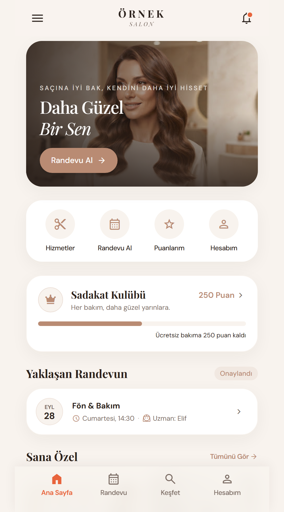
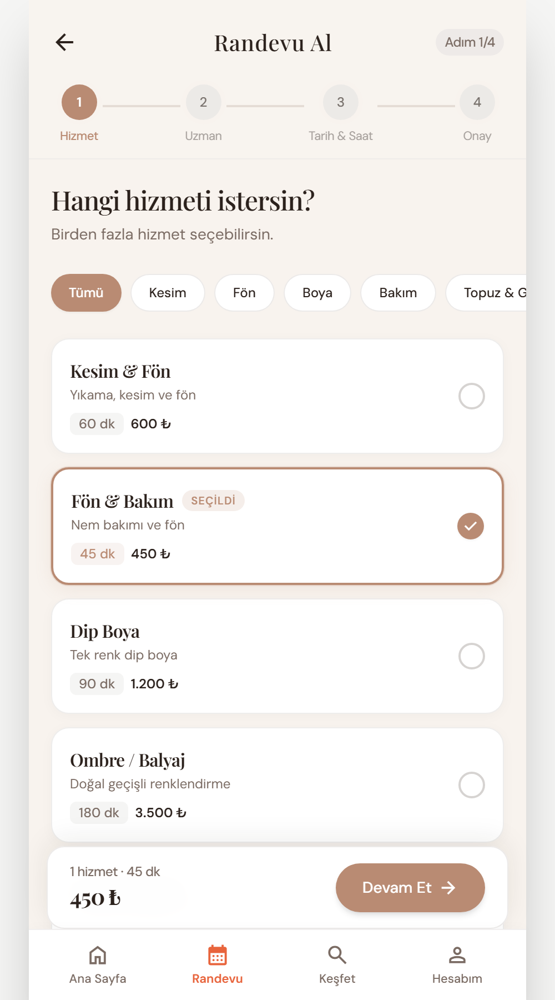
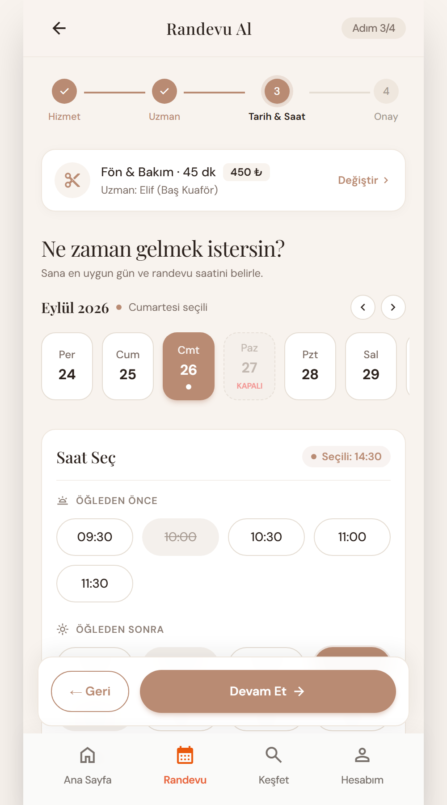
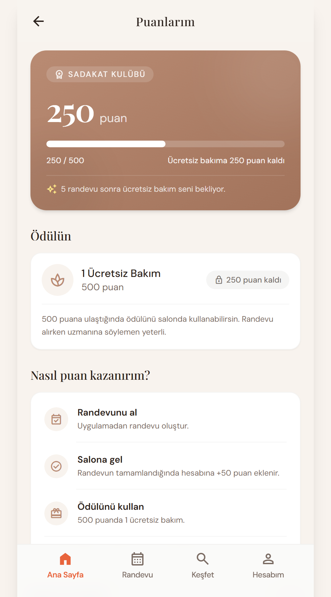

# Kuaför Randevu ve Sadakat Platformu

https://github.com/user-attachments/assets/2a437d70-3f9b-459f-907e-fb06d0f904c2

Tek bir kuaför salonu için hazırlanmış, salonun kendi adıyla yayınlanacak randevu ve sadakat sistemi. Amaç mevcut müşteriyi elde tutmak: müşteri uygulamadan randevu alır, her ziyarette puan kazanır; salon sahibi web panelinden randevuları, ciroyu ve müşterileri yönetir.

Üç parçadan oluşur:

- **Müşteri uygulaması** (`mobil/`): iOS ve Android, React Native + Expo
- **Salon paneli** (`panel/`): Next.js web uygulaması, ayrıca hesapsız web randevu sayfası
- **Veritabanı** (`supabase/`): Supabase üzerinde PostgreSQL; iş kuralları ve yetkiler veritabanında

Ayrı bir sunucu yoktur. Randevu çakışması, puan, iptal süresi ve bildirim kuyruğu gibi kuralların tamamı SQL fonksiyonları ve satır düzeyinde güvenlik (RLS) ile veritabanında çalışır.

## Ekranlar

| Ana sayfa | Hizmet seçimi | Tarih ve saat | Puanlarım |
|---|---|---|---|
|  |  |  |  |

Tüm ekran tasarımları `tasarimlar/` klasöründedir; `tasarimlar/giris.html` dosyasından tıklanarak gezilebilir.

## Özellikler

### Müşteri uygulaması

- E-posta ile kayıt ve giriş; giriş yapmadan hizmetlere göz atma
- 4 adımlı randevu akışı: hizmet (birden fazla seçilebilir) → uzman ("Farketmez" seçeneğiyle) → tarih ve saat → onay
- Randevularım: yaklaşan ve geçmiş randevular, iptal, başka saate alma, "Tekrar Randevu Al"
- Sadakat kulübü: tamamlanan her randevuya puan, puan geçmişi, ödül
- Keşfet: kampanyalar, salonun çalışmalarından galeri, uzmanlar, salon bilgileri ve yol tarifi
- Bildirimler: randevu hatırlatması, salon iptali, kampanya duyurusu
- Hesabım: profil, şifre değiştirme, bildirim tercihleri, hesap silme
- Web'den alınan randevuyu aktarma koduyla hesaba ekleme

### Salon paneli

- **Randevular:** uzman sütunlu günlük takvim; tamamlandı, gelmedi, iptal; hesabı olmayan müşteriye randevu girme
- **Ciro raporu:** haftalık ve aylık; gerçekleşen, bekleyen, kayıp; günlük grafik; hizmete ve uzmana göre kırılım; salonda tahsil edilen tutarın girilmesi
- **Müşteriler:** sık gelenler, uzun süredir gelmeyenler, kampanya izni verenler; ödül kullandırma
- **Hizmetler ve uzmanlar:** ekleme, düzenleme, pasife alma, silme; uzmana hizmet atama
- **Kampanyalar ve galeri:** tarihli kampanyalar, fotoğraf yükleme, seçili müşterilere bildirim
- **Ayarlar:** salon bilgileri, çalışma saatleri, tatil günleri, puan ve iptal kuralları

### Web randevu sayfası

Panelde `/randevu` adresinde, herkese açık ve hesap gerektirmeyen randevu sayfası (örneğin Instagram biyografisine konmak için). Aynı numarayla alınabilecek randevu sayısı ve saatlik toplam sınırlıdır.

## İş kuralları

Varsayılan değerler; hepsi panelden değiştirilebilir.

- Tamamlanan her randevu 50 puan, 500 puan 1 ücretsiz bakım. Puan randevu "tamamlandı" işaretlenince eklenir.
- Randevudan 2 saat öncesine kadar uygulamadan iptal edilebilir.
- Hatırlatma bildirimi randevudan 1 gün ve 2 saat önce gider.
- Ödeme salonda yapılır, uygulamada online ödeme yoktur.

## Teknolojiler

| Parça | Kullanılanlar |
|---|---|
| Mobil | React Native, Expo SDK 57, Expo Router, TypeScript, expo-notifications |
| Panel | Next.js 16 (App Router), React 19, Tailwind CSS 4, TypeScript |
| Backend | Supabase: PostgreSQL, Auth, Storage, RLS, `pg_cron`, `pg_net` |
| Bildirim | Expo Push Notifications |

## Klasör yapısı

```
mobil/               Müşteri uygulaması (Expo)
  src/app/           Ekranlar: sekmeler, randevu akışı, giriş, kayıt
  src/lib/           Supabase istemcisi, oturum, tema, saat aralığı hesapları
panel/               Salon paneli ve web randevu sayfası (Next.js)
  src/app/(panel)/   Randevular, ciro, müşteriler, hizmetler, uzmanlar, kampanyalar, galeri, ayarlar
  src/app/randevu/   Herkese açık web randevu sayfası
supabase/
  migrations/        Şema, iş kuralı fonksiyonları ve RLS (0001 → 0012)
  tests/             SQL testleri
  demo/              Tanıtım için örnek veri
tasarimlar/          Ekran tasarımları (HTML + PNG)
satis/               HTML'den PDF üreten betik
PLAN.md              Kararlar, yol haritası ve yapılanların ayrıntılı kaydı
```

## Kurulum

Gerekenler: Node.js ve bir Supabase projesi.

### 1. Veritabanı

`supabase/migrations/` içindeki dosyaları numara sırasıyla Supabase SQL Editor'de çalıştır. `supabase/tests/` altındaki dosyalar iş kurallarını doğrular.

Salon sahibinin hesabını yönetici yapmak için:

```sql
update public.profiller set rol = 'yonetici' where eposta = '...';
```

### 2. Müşteri uygulaması

`mobil/.env` dosyasını oluştur:

```
EXPO_PUBLIC_SUPABASE_URL=https://<proje>.supabase.co
EXPO_PUBLIC_SUPABASE_PUBLISHABLE_KEY=<publishable anahtar>
```

```sh
cd mobil
npm install
npm start
```

### 3. Salon paneli

`panel/.env.local` dosyasını oluştur:

```
NEXT_PUBLIC_SUPABASE_URL=https://<proje>.supabase.co
NEXT_PUBLIC_SUPABASE_PUBLISHABLE_KEY=<publishable anahtar>
```

```sh
cd panel
npm install
npm run dev
```

Panel `http://localhost:3000` adresinde açılır. Yalnızca yönetici rolündeki hesaplar girebilir.

Logodaki salon adı ortam değişkeniyle değişir: mobilde `EXPO_PUBLIC_LOGO_UST` / `EXPO_PUBLIC_LOGO_ALT`, panelde `NEXT_PUBLIC_LOGO_UST` / `NEXT_PUBLIC_LOGO_ALT`.

## Durum

Müşteri uygulamasının ve panelin ilk sürümü, sadakat puanı ve web randevu sayfası hazır. Push bildirimlerinin kodu yazıldı; telefonda çalışması için Expo, Firebase ve Apple Developer hesapları gerekiyor. Mağaza yayını ve panelin internete açılması henüz yapılmadı. Ayrıntılar `PLAN.md` dosyasında.
